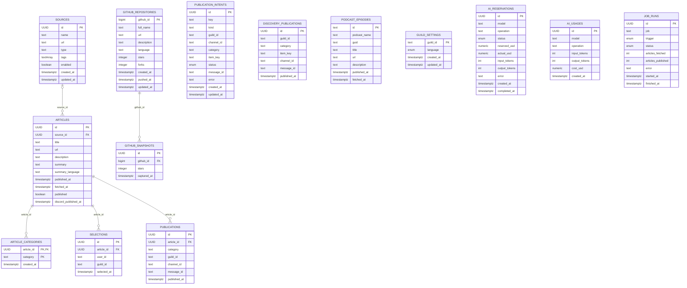

# Data Model

The source schema consists of **14 PostgreSQL tables** defined in `src/database/schema/` using Drizzle ORM. The diagram below shows physical foreign keys; dotted or logical associations are **not** silently presented as SQL foreign keys.

An article may have no source: `source_id` is nullable and source deletion sets it to null. Mermaid shows this optional relationship; Graphviz renders the foreign-key links with simplified `1:N` labels.

## Editable ER diagram

## Tables and responsibilities

| Table                    | Role                                                 |
| ------------------------ | ---------------------------------------------------- |
| `sources`                | Configured RSS feed catalog and enablement           |
| `articles`               | Unique-by-URL RSS articles and cached AI summaries   |
| `article_categories`     | Many-to-many category association                    |
| `selections`             | Personal article selections within a guild           |
| `publications`           | Successful RSS Discord deliveries                    |
| `publication_intents`    | Durable claim, send state and recovery marker        |
| `discovery_publications` | GitHub/podcast delivery history and deduplication    |
| `github_repositories`    | Last known repository metadata                       |
| `github_snapshots`       | Historical GitHub star counts                        |
| `podcast_episodes`       | Discovered podcast episodes                          |
| `guild_settings`         | Per-guild generated content language                 |
| `ai_reservations`        | Pre-flight AI cost reservation and uncertainty state |
| `ai_usages`              | Charged request cost and token metrics               |
| `job_runs`               | Scheduled-job execution records                      |

## Physical foreign keys

- `articles` → `sources` using `source_id (SET NULL)`.
- `article_categories` → `articles` using `article_id (CASCADE)`.
- `selections` → `articles` using `article_id (CASCADE)`.
- `publications` → `articles` using `article_id (CASCADE)`.
- `github_snapshots` → `github_repositories` using `github_id (CASCADE)`.

## Other logical links

`publication_intents` uses `kind`, `category` and `item_key` to represent either an RSS article or a discovery item. Those fields are **not declared as a SQL foreign key**. `discovery_publications` similarly stores a logical item key rather than an FK to `github_repositories` or `podcast_episodes`. `guild_id` and `user_id` are Discord snowflakes stored as text, not references to local user/guild tables. There is no user/account table.

## Constraints and consistency

- `articles.url` and `sources.url` are unique.
- `article_categories` has composite primary key `(article_id, category)`.
- `selections` has a unique index on `(user_id, article_id, guild_id)`.
- `publications` has a unique index on `(article_id, category, guild_id)` and globally unique `message_id`.
- `discovery_publications` has a unique index on `(guild_id, category, item_key)`.
- `publication_intents.key` is unique.
- Monetary columns use `numeric(14,10)`; values must not be treated as JavaScript floating-point financial truth.
- `publication_intent_status` is `pending | sending | published | uncertain`. `ai_reservation_status` is `reserved | completed | uncertain`. `job_status` is `running | success | failed`; `job_trigger` is `cron | manual`.

## Migrations

Migrations are stored in `drizzle/` and generated from `src/database/schema/`. Use `npm run db:generate`, inspect the SQL, then `npm run db:migrate`. Do not drop existing tables or manually rewrite migration history in production.
