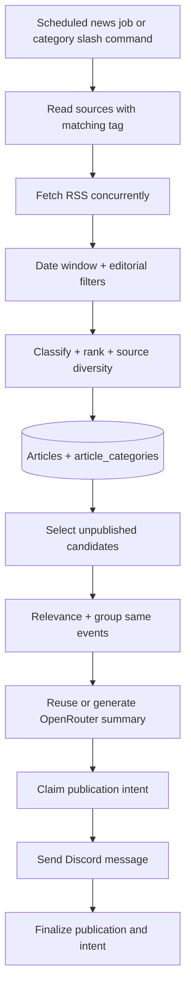
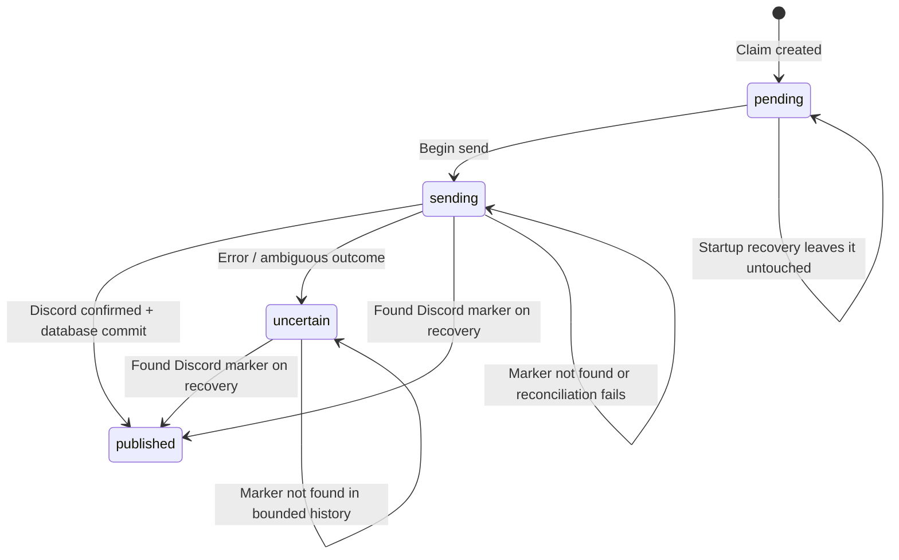

# Processing Pipelines

## RSS news — scheduled or slash command

The `daily` mode fetches RSS content only when daily publication slots remain; `/more` consumes previously collected, still-unpublished articles. Candidate selection filters out articles older than 24 hours and events covered recently, and limits representative items from one source.

## GitHub/podcast discovery

A discovery job fetches GitHub repositories or podcast episodes; stores items/snapshots, selects candidates, checks publication history, claims an intent and posts an embed. Discovery posts are **not** AI article summaries. GitHub search targets recently created repositories; podcast sources come from `podcasts.json`.

## User-generated briefing

1. A user clicks **Select** on one or more RSS article messages.
2. The selection toggle persists `(guild, user, article)`.
3. `/summarize` gathers that user's selections and requests a 3,072-token completion. `OPENROUTER_MAX_OUTPUT_TOKENS` must be at least `3072`; the source default of `2048` rejects the request before contacting OpenRouter.
4. Mayu validates the Markdown, appends source links and sends an `.md` attachment through a Discord DM.
5. After a successful DM send, Mayu attempts to clear only the selections included in that briefing. Selections added for other articles during generation remain. If delivery fails, selections are retained; a database failure during clearing can also leave delivered selections intact.

## Crash-safe publication state machine

A unique identity key prevents another blind send. Startup recovery looks for a `mayu-publication:<UUID>` marker among the last **100** messages in the destination text channel. No marker in this bounded result is **not evidence of non-delivery**; manual reconciliation may be necessary. Publication finalization uses a PostgreSQL advisory transaction lock. Pending intents are skipped and still prevent a new claim for the same identity; normal jobs do not automatically retry them. Unreconciled sending intents remain `sending` in the database, even though recovery counts them as uncertain outcomes. There is no operator retry/reconciliation command.

## Key consistency caveats

- RSS collector's daily storage quota is computed by **UTC** day; RSS publication quota uses a **Europe/Paris** day boundary.
- Discovery publication quota currently uses a **UTC** day boundary.
- `articles.isPublished` is a global flag, while publication records are keyed by guild/category. This is another reason not to describe the current version as multi-guild capable.
