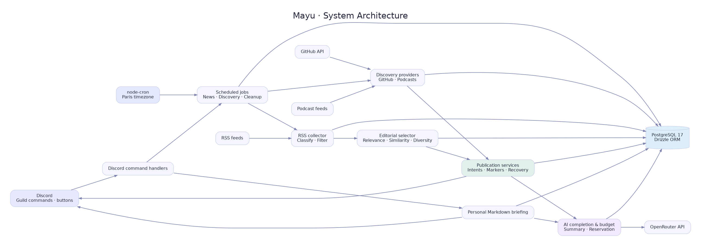
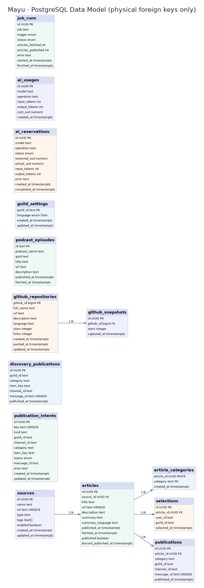

# Mayu — Technical Documentation

> **Less scrolling. More knowing.**

This documentation describes the implementation of [Mayu](https://github.com/BxptisteM/Mayu), a Discord-first technology intelligence bot. It is based on the repository's `main` branch inspected on **2026-10-14**. Source code remains the ultimate authority when documentation and implementation diverge.

## Read by role

| Audience       | Start here                                                                                  |
| -------------- | ------------------------------------------------------------------------------------------- |
| Server members | [User guide](USER_GUIDE.md), [Commands](COMMANDS.md)                                        |
| Operators      | [Configuration](CONFIGURATION.md), [Deployment](DEPLOYMENT.md), [Operations](OPERATIONS.md) |
| Contributors   | [Architecture](ARCHITECTURE.md), [Data model](DATA_MODEL.md), [Development](DEVELOPMENT.md) |
| Reviewers      | [Security](SECURITY.md), [Known limitations](KNOWN_LIMITATIONS.md)                          |

## Reference index

- [Architecture and components](ARCHITECTURE.md)
- [End-to-end pipelines](PIPELINES.md)
- [Database schema and relationships](DATA_MODEL.md)
- [Slash commands and permissions](COMMANDS.md)
- [Scheduled and manually triggered jobs](JOBS.md)
- [Source configuration and editorial selection](SOURCES.md)
- [AI summarization and budget enforcement](AI.md)
- [Configuration reference](CONFIGURATION.md)
- [Local development and testing](DEVELOPMENT.md)
- [Deployment guide](DEPLOYMENT.md)
- [Operations and recovery](OPERATIONS.md)
- [Security and trust boundaries](SECURITY.md)
- [Known limitations and review points](KNOWN_LIMITATIONS.md)
- [Diagram source and rendering](diagrams/README.md)

## Architecture at a glance

## Data model at a glance

Documentation covers the **current source implementation**, not an aspirational multi-server or CI/CD design.
